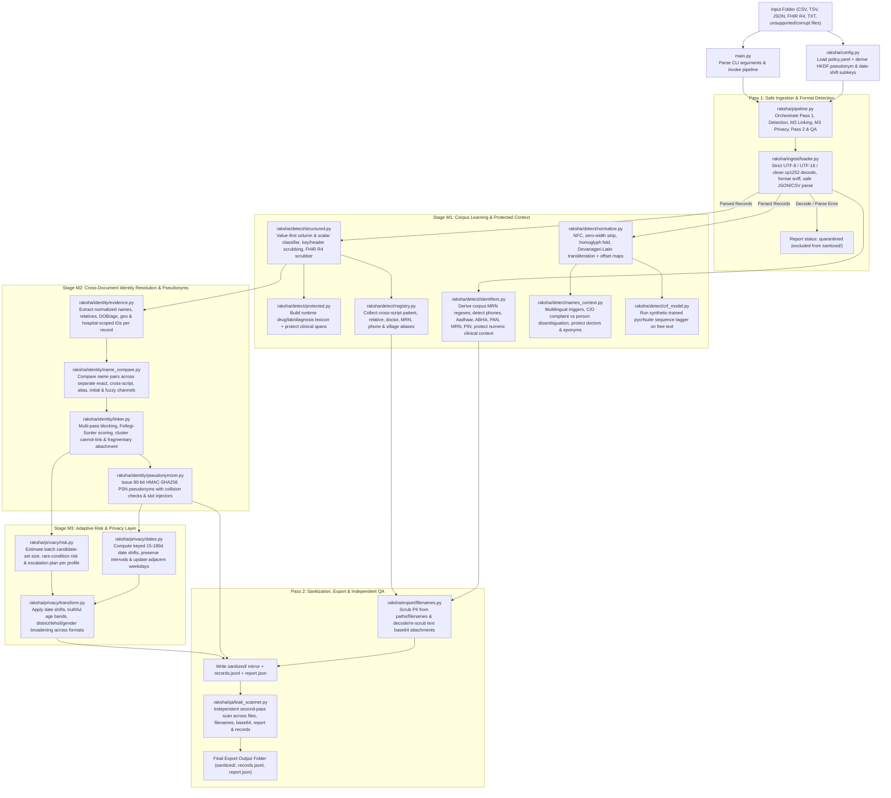

# RakshaGuard System Architecture

RakshaGuard is an offline, secret-keyed healthcare data de-identification and privacy-preserving release system built for Indian multi-hospital exports (CSV, TSV, nested JSON, FHIR R4 Bundles, and English/Hindi/Hinglish free text).

It reads a folder of raw clinical files plus an external secret key (`RAKSHA_SECRET`), links records belonging to the same patient, applies secret-keyed date shifts and adaptive age/location generalization to resist re-identification attacks, scrubs every personal identifier, renames leaky file paths, and verifies the exported output with a separate zero-shared-state leakage scanner.

---

## 1. End-to-End Data Flow (`input/` -> `output/`)

---

## 2. Module-by-Module Reference

### `main.py`
The command-line entry point (`--input`, `--output`) validates CLI flags and hands execution over to `run_pipeline`. It configures the process cleanly and forwards the integer exit code (`0` on success, non-zero on missing secret) to the caller. This keeps argument parsing completely isolated from sanitization logic.
- **Inputs:** CLI flags `--input <path>` and `--output <path>`.
- **Outputs:** Exit status code (`0` or `1`) and console summary printed by the pipeline.

### `raksha/config.py`
This module reads privacy thresholds from `config/policy.yaml` (such as default 5-year age bands, maximum 180-day date shift, and minimum k-anonymity group size `5`) and validates the `RAKSHA_SECRET` environment variable, rejecting only missing or empty secrets. Using HKDF-SHA256, it derives separate cryptographic subkeys for pseudonyms and date shifts so neither task shares key material. It also provides baseline deterministic HMAC pseudonym, date-shift, and age-band helper functions.
- **Inputs:** `RAKSHA_SECRET` environment variable and `config/policy.yaml`.
- **Outputs:** Policy dictionary, cryptographic subkeys (`bytes`), and base helper values.

### `raksha/pipeline.py`
The central coordinator executes two clean passes across the dataset so that every decision has full corpus context before any output file is written. In Pass 1 it decodes and parses all files, derives runtime MRN formats, builds the clinical lexicon and alias registry, links patients (`M2`), and computes per-profile privacy plans (`M3`). In Pass 2 it scrubs PII, applies generalizations, injects patient `PSN-...` identifiers into records, writes `sanitized/`, `records.jsonl`, and `report.json`, and invokes the independent QA audit.
- **Inputs:** Input folder path, output folder path, and optional policy override.
- **Outputs:** Complete output directory (`sanitized/`, `records.jsonl`, `report.json`) and process exit code.

### `raksha/ingest/loader.py`
This ingestion guard safely decodes incoming files from UTF-8, UTF-8 with BOM, UTF-16, or clean Windows-1252 punctuation while strictly rejecting raw binary garbage, NUL bytes, corrupt encodings, and empty files. It detects JSON payloads disguised behind `.csv` or `.tsv` extensions, enforces a safe recursion limit (for 1,500-level deep JSON), and translates parse failures into standardized quarantine reason codes. No unparseable or unsupported file ever reaches downstream export.
- **Inputs:** Raw file path and raw bytes from disk.
- **Outputs:** Decoded UTF-8 strings, canonical format tag (`csv`, `tsv`, `json`, `txt`), and structured CSV/JSON objects (or typed `ValueError` quarantine reasons).

### `raksha/detect/normalize.py`
Clinical notes frequently mix Unicode forms, invisible zero-width characters, Cyrillic/Greek lookalike homoglyphs, Devanagari numerals, and Hindi/Hinglish text. This module constructs a dual `NormalizedView` that cleans all obfuscations, converts Devanagari numerals to ASCII, transliterates Devanagari words to Latin (`indic-transliteration`), and stores character-by-character index maps back to the unmodified source string. It also provides a script-agnostic `phonetic_key` so cross-script spellings can be matched reliably.
- **Inputs:** Raw string (`text`).
- **Outputs:** `NormalizedView` (`clean`, `latin_folded`, `clean_to_orig`, `folded_to_orig`) and phonetic strings.

### `raksha/detect/structured.py`
This detector inspects every CSV/TSV column and JSON key-value tree by analyzing the actual cell values first (e.g., phone shapes, PAN, Aadhaar, numeric 12/14-digit integers stored under misspelled JSON keys, composites addresses) and falling back to multilingual header/key synonyms. It scrubs PII out of CSV headers and JSON object keys deterministically while avoiding key collisions. For FHIR R4 Bundles, it sanitizes `Patient`, `Composition`, `Encounter`, and `DocumentReference` base64 attachments in place while preserving R4 syntax, code systems, and internal UUID references.
- **Inputs:** Parsed tabular rows, arbitrary JSON objects, free-text scrubber callback, and entity counters.
- **Outputs:** Column semantic types and sanitized tabular rows, JSON structures, and FHIR R4 Bundles.

### `raksha/detect/identifiers.py`
This module applies pattern matching over normalized free text to locate Indian phones (`+91`, spaces/dashes, Devanagari digits, extensions, masked numbers), Aadhaar (full 4-4-4 and masked), 14-digit ABHA numbers, ABHA addresses, emails, PAN cards, insurance IDs, labeled DOBs, PIN codes, and MRNs. It dynamically synthesizes new regexes from hospital-specific MRN shapes discovered during Pass 1 structured table inspection. A built-in numeric context classifier explicitly protects clinical numbers such as platelet counts, lab reference ranges, medication doses, and blood-pressure readings.
- **Inputs:** Free text (`str`), `NormalizedView`, and corpus-derived MRN regex list.
- **Outputs:** Non-overlapping `Span` detections (`label`, original offsets) and redacted strings.

### `raksha/detect/names_context.py`
Rather than relying on fixed lookup lists of Indian names, this detector discovers person names, relatives, and address fragments in free text via multilingual contextual cues (English `Name:`, `Pt.`, `S/o`/`D/o`/`W/o`; Hindi `नाम:`, `मरीज़ का नाम:`, `को X दिन से`; Hinglish `ji`, `sahab`, `ka BP`; WhatsApp timestamps). It disambiguates `C/O <symptom>` clinical complaints from `C/O <person>` care-of names using multi-token right/left context. Explicitly marked doctor names (`Dr.`, `डॉ.`, `Consultant`), ASHA workers, and disease eponyms (`Parkinson's disease`) are flagged as protected spans.
- **Inputs:** Free text, `NormalizedView`, and optional protected spans.
- **Outputs:** Lists of protected clinical/doctor spans and contextual `PATIENT_NAME`, `RELATIVE_NAME`, and `Address` component `Span` objects.

### `raksha/detect/protected.py`
To prevent over-redaction of life-saving clinical context, this module dynamically harvests drug names, lab test names, and diagnosis/procedure terms from structured tables and clean formulary files at run time, combining them with core medicine/lab patterns. It scans free text for medications, dosage units (`mg`, `mcg`, `IU`), schedules (`BD`, `1-0-1`), vitals (`150/90`, `Temp 100 F`), lab units, ICD-10 codes, and Hindi/Hinglish clinical phrases. Its span resolver guarantees that protected clinical and doctor spans always win any overlap conflict against PII detectors.
- **Inputs:** Parsed input items from Pass 1, free text, candidate PII spans, and protected spans.
- **Outputs:** Dynamic `ClinicalLexicon`, protected clinical `Span` lists, and clean non-overlapping PII spans.

### `raksha/detect/registry.py`
During Pass 1, this module collects every high-confidence patient name, relative name, doctor name, phone, MRN/UHID, and village observed in structured fields and FHIR `Patient`/`Practitioner` resources. It automatically expands every entry into Latin/Devanagari transliterations, phonetic keys, reversed token orders, and common `Mohammad/Mohd/Md` spelling variants while strictly filtering out generic single tokens like `Devi` or `Kumar` and protecting full doctor names. In Pass 2, it proposes candidate matches across free text, filenames, and base64-decoded notes for resolution against clinical context.
- **Inputs:** Parsed Pass 1 items (structured rows, JSON, FHIR) and target strings/filenames.
- **Outputs:** Populated `AliasRegistry` proposing cross-script `Span` candidates.

### `raksha/detect/crf_model.py`
This module wraps a compact binary Conditional Random Field (`models/pii_crf.crfsuite`, `40.5 KB`) trained offline on synthetic `Faker` clinical notes so RakshaGuard can recognize unseen canary names in context without memorizing any name list. It tokenizes text while preserving exact character offsets and extracts local context cues, script tags (`LATIN`, `DEVA`), word shapes, character 3-grams, and prefix/suffix features across a ±2 token window. Predicted spans pass through safety filters (requiring non-stopword capitalized/Devanagari tokens) and protected-span conflict resolution before redaction.
- **Inputs:** Free text string and bundled binary model file (`models/pii_crf.crfsuite`).
- **Outputs:** Context-predicted `PATIENT_NAME` and `RELATIVE_NAME` `Span` objects.

### `raksha/export/filenames.py`
Personal identifiers often hide in file/directory names (such as a patient's name, phone number, or MRN) and inside base64-encoded JSON text fields. This module replaces detected PII segments inside relative paths using identifier patterns and the run-level `AliasRegistry`, appending a short hash of the raw input (`input_sha256[:8]`) plus collision checks so output paths remain unique and deterministic. It also decodes printable UTF-8 base64 payloads (skipping binary PDF/JPEG/PNG headers), runs the text scrubber on the decoded content, and re-encodes cleanly.
- **Inputs:** Relative input path, input SHA-256, `AliasRegistry`, extra MRN regexes, and base64 string values.
- **Outputs:** Sanitized collision-free relative export paths and sanitized base64 strings.

### `raksha/identity/evidence.py`
Before any records can be anonymized cleanly across a patient's history, all identifying clues must be gathered into one structured profile per record unit (`row:N`, `/key/N`, or `doc`). This module reads tabular columns, iteratively traverses nested JSON (safe at 1,500+ depth), parses FHIR `Patient`/`Encounter` resources, and scans free-text headers and dates while inferring `DD/MM/YYYY` vs `MM/DD/YYYY` dynamically and skipping static non-patient files. It records normalized + phonetic name tokens, relatives, DOB/age, gender, location, phones, national IDs, and `(hospital, MRN)` pairs alongside a content-only SHA-256 hash.
- **Inputs:** All Pass 1 parsed items `(rel, fmt, payload)`.
- **Outputs:** List of deterministic `RecordEvidence` objects and canonical JSON record unit locators.

### `raksha/identity/name_compare.py`
Collapsing names into one string loses critical clues when scripts, initials, or transliterations differ, so this module evaluates name pairs across independent evidence channels. It scores exact normalized equality, cross-script transliteration/phonetic matching (with Indian diphthong vowel folding), corroborated `Mohammad/Mohd/Md` aliases (rejecting uncorroborated `Md.`), initials plus surname, reversed token order, and `rapidfuzz` string similarity, alongside strict single-token fragmentary rules. It also compares relative names and relation prefixes (`S/o`, `D/o`, `W/o`).
- **Inputs:** Lists of `NameForm` and `RelativeClue` objects for two records.
- **Outputs:** `NameComparison` diagnostic object (`best_level` in `exact`, `fuzzy`, `phonetic`, `given_only`, `weak`, `disagree`) and relative agreement flag.

### `raksha/identity/linker.py`
To unite records across hospitals without letting homonyms collapse together, this module performs 5-pass candidate blocking (strong IDs, full phonetic/initial names, name+relative, name+age bucket, and phone+name/phone) followed by Fellegi-Sunter weighted scoring. Weighting treats phone sharing as weak (because relatives share phones), handles re-registration with a new MRN at the same hospital gently, enforces hard vetoes for conflicting exclusive IDs (Aadhaar/ABHA/PAN), and checks all member pairs across candidate clusters before merging to block transitive `A~B, B~C, A!=C` chaining. Ambiguous single-token fragmentary notes attach only if a single core cluster exceeds threshold with clear margin, sorting all operations by content hash so results remain invariant under input shuffling.
- **Inputs:** List of `RecordEvidence` objects across the dataset.
- **Outputs:** `ClusterResult` mapping `(rel, loc)` -> `cluster_id` (`null`/omitted when unlinked or ambiguous) and grouped `clusters`.

### `raksha/identity/pseudonymizer.py`
Each confident patient cluster receives an unlinkable pseudonym built from a canonical cluster fingerprint combining its strongest immutable identifiers and demographic anchors (never relying on plaintext names alone). The pseudonym is generated as `PSN-` followed by 16 Crockford base32 characters (`80` bits) from `HMAC-SHA256(psn_key, fingerprint)` with an explicit collision map incrementing a `#c{nonce}` counter if two distinct clusters ever collide. During export, dedicated injectors place the `PSN` directly inside each record's primary `[MRN]` or `[PATIENT_NAME]` slot across CSV cells, JSON leaves, FHIR `Patient` resources, and free text without breaking schema or adding columns.
- **Inputs:** Resolved `clusters`, `psn_key`, and already-redacted output structures.
- **Outputs:** Cluster-to-`PSN` dictionary and modified records containing the embedded `PSN-...` string.

### `raksha/privacy/dates.py`
All clinical timelines must preserve real visit gaps and lengths of stay without exposing true calendar dates across a release or allowing two secret keys to match. This module derives signed integer offsets between `15` and `date_shift_max_days` (`180` default) via `HMAC-SHA256`, keyed by `PSN` for linked patients and by `content_hash` for unlinked documents. It shifts ISO8601 datetimes, `DD/MM/YYYY`, `MM/DD/YYYY`, `DD.MM.YYYY`, `DD-MM-YYYY`, and WhatsApp short dates in place while dynamically inferring month-first conventions and updating adjacent English or Hindi weekday names to match the new calendar day.
- **Inputs:** Raw date strings or free text, shift key/IDs, and inferred month-first flag.
- **Outputs:** Date-shifted strings/documents with intervals intact and weekday names synchronized.

### `raksha/privacy/risk.py`
This engine evaluates re-identification exposure for every linked patient profile (or unlinked patient document) strictly from the current dataset's own empirical demographic and diagnosis/procedure distributions without ever consulting external answer keys. Assuming an estimated population catchment multiplier (`4.5x` with minimum floor `180`) and realistic age-pyramid tail densities, it computes an expected candidate-set size `k_est` and escalates each profile's `PrivacyPlan` step by step until `k_est >= min_group_size` (boosted further when a diagnosis/procedure appears in `<= 3` profiles). The escalation ladder moves from baseline `tehsil` removal -> `5/10/20`-year age widening (plus `80+`/`85+` elderly caps) -> `district` broadening -> `gender` coarsening -> full age suppression (`[AGE]`), always sparing clinical diagnoses, medicines, vitals, and lab values.
- **Inputs:** Parsed inputs, `RecordEvidence` list, `ClusterResult`, `cluster_to_psn`, `PolicySettings`, and `shift_key`.
- **Outputs:** Dictionary mapping `(rel, loc)` -> `PrivacyPlan` (shift offset, age band width/cap, location/gender flags, and risk estimates).

### `raksha/privacy/transform.py`
This transformer enforces each record's assigned `PrivacyPlan` uniformly across CSV/TSV rows, arbitrary JSON dicts/arrays, FHIR R4 Bundles, base64 attachments, and free-text documents. It converts exact ages into guaranteed-truthful bands (`lo-hi` or `top_cap+`) without altering clinical duration strings (`8 yrs back`) or lab reference ranges (`70-140`), drops/generalizes `tehsil` and `district` tokens according to the plan, omits `Patient.birthDate` in FHIR when widened/risky (`gender -> "unknown"` if coarsened so R4 validation holds), and shifts metadata/clinical timestamps consistently. Static documents under `clean/` and non-patient files pass through untouched.
- **Inputs:** Sanitized tabular rows, JSON structures, FHIR Bundles, or text strings + assigned `PrivacyPlan` objects.
- **Outputs:** Privacy-transformed output structures and exact per-record boolean flags indicating whether any generalization took place.

### `raksha/qa/leak_scanner.py`
Built with zero shared imports or runtime state from `raksha/detect/`, this independent auditor acts as a final safety gate on the finished output directory (`sanitized/`, filenames, decoded base64 payloads, `report.json`, and `records.jsonl`). It compiles every known PII phrase and identifier core into an independent normalizer/matcher alongside raw regexes for phones, Aadhaar, ABHA, PAN, and emails, re-evaluating surrounding context so preserved doctors, clinical measurements, and disease eponyms are never falsely flagged. If any residual leak slips past Pass 2, the scanner either safely re-scrubs and double-checks the file or quarantines it cleanly while keeping `report.json` and `records.jsonl` counts honest.
- **Inputs:** Output directory (`sanitized/`, `report.json`, `records.jsonl`) plus plain snapshot sets (`known_surfaces`, `doctor_surfaces`).
- **Outputs:** Updated/verified `sanitized/`, `records.jsonl`, `report.json`, and an `AuditSummary`.

---

## 3. Rule, Lexicon, Regex & Parameter Provenance Audit

| Component / Artifact | Category | Provenance / Source | Derived from `dev/input` or `dev/truth`? |
|---|---|---|---|
| Value-first regexes (Phone, Aadhaar, Masked Aadhaar, ABHA, Email, PAN, Insurance) (`identifiers.py`, `structured.py`) | Hardcoded regexes | Standard Indian national/healthcare ID formats & RFC email/PIN rules | **No** (`dev/truth` never read; standard public formats) |
| `_MRN_PATTERNS` / `_RE_MRN` structural shapes (`identifiers.py`, `structured.py`, `evidence.py`, `filenames.py`) | Hardcoded generic prefix+digit skeletons | General Indian HIS ID shapes (`[A-Z]{2,6}/\d{2,4}/\d{3,}`, `[A-Z]{2,6}-\d{4,}`, etc.) | **No** (hospital-specific literals were purged in pre-M2 hardening commit `cc5864e`) |
| `derive_id_patterns_from_values` (`identifiers.py`) | **Derived at run time** | Synthesizes regexes from column values classified as `MRN` in the current run's input folder | Run-time input only (zero `dev/truth`) |
| Numeric clinical context & units (`identifiers.py`, `protected.py`) | Hardcoded patterns | Standard clinical units (`mg/dL`, `g/dL`, `/uL`, `1-0-1`, `BP`, `°F`), drug dosage forms (`Tab`, `Inj`), INN drug suffixes (`-mycin`, `-pril`, `-statin`) | **No** (standard pharmacology/clinical notation) |
| `_BASE_DRUGS`, `_BASE_LABS`, `_HINDI_CLINICAL_RE` (`protected.py`) & `_PROSE_OR_CLINICAL_STOPWORDS` (`structured.py`, `names_context.py`, `crf_model.py`) | Hardcoded base lexicons | Essential medicines/labs plus common Hindi clinical phrasing (`दिन से बुखार`, `theek se neend`, `oxygen given en route`) | **Flagged (partly inspired by `dev/input`)**: core drugs/labs are general medical terms; specific Hinglish nursing/transport phrases (`theek se neend`, `band ho gayi`, `dawai`, `oxygen given en route`, `ambulance_log` stopwords) were added while inspecting `dev/input` notes/logs |
| `ClinicalLexicon` (`protected.py`) | **Derived at run time** | Harvests drug, lab test, diagnosis, and procedure strings dynamically from current batch's `clean/` formularies and structured tables/JSON | Run-time input only (`clean/` formularies in current batch) |
| Multilingual name triggers & `C/O` rules (`names_context.py`) | Hardcoded rules | English/Hindi/Hinglish demographic triggers (`Name:`, `Pt.`, `S/o`/`W/o`/`D/o`, `ji`, `sahab`, `मरीज़ का नाम`, `पिता का नाम`) + symptom-vs-person context check | **Flagged (partly shaped by `dev/input` layouts)**: WhatsApp header bracket format, `HH:MM - Name - K/C/O` pattern, comma lookbehind before `Tehsil`, and Hinglish postpositions (`ka BP`, `ki condition`) match styles seen in `dev/input` |
| `AliasRegistry` (`registry.py`) | **Derived at run time** | Collects patient/relative/doctor names, MRNs, phones, and villages from structured fields in Pass 1 and expands Latin<->Devanagari variants (`_MD_ALIASES`, reversed token order) | Run-time input only (`_GENERIC_SINGLE_TOKENS` stopwords like `devi`, `kumar`, `kalan`, `bazar` are hardcoded pan-Indian tokens) |
| `models/pii_crf.crfsuite` (`crf_model.py`, `tools/train_crf.py`) | **Learned offline** | Trained using `sklearn-crfsuite` on `500` synthetic `Faker(['en_IN', 'hi_IN'])` + synthetic canary patients rendered across `33` clinical note templates | **Flagged (templates imitate `dev/input` note styles)**: never trained on `dev/input` or `dev/truth` entities, though the synthetic sentence templates imitate `dev/input` formats (nursing notes, WhatsApp headers, prescriptions) |
| Date-order inference (`infer_month_first`) (`dates.py`, `evidence.py`, `transform.py`) | **Derived at run time** | Infers `MM/DD/YYYY` vs `DD/MM/YYYY` from unambiguous `>12` day/month tokens or short admission-to-discharge spans in the current file (previously used hardcoded `"arogya"` filename hints, removed in audit) | **No** (`dev/input` filename hints removed; purely value-driven) |
| Non-patient static file skip (`_NON_PATIENT_FILES`, `_NON_PATIENT_PATH_TOKS`) (`evidence.py`, `risk.py`) | Path prefix (`clean/`) + structural schema check | Passes `clean/` reference directories through unchanged and skips CSV/TSV/TXT files with zero QI/patient columns or evidence (previously listed `ward_census`, `drug_formulary`, `lab_reference_ranges`, `readme_export`, `ambulance_log`, removed in audit) | **No** (practice filename literals removed in overfitting audit) |
| Structured dictionary keys (`uhid`, `patient_ref`, `hospital_uhid`, `guardian`, `raised_by`, `mariz_naam`, `abdm_addr`, etc.) & `_NON_PII_KEY_TOKENS` (`evidence.py`, `structured.py`, `registry.py`) | Hardcoded key synonyms | Maps column/JSON field names when value inference is insufficient (`"dengue_cases"` replaced with generic `"cases"`, `"case_count"` in audit) | **Flagged (partially informed by `dev/input`)**: includes both general Indian synonyms and exact schema keys (`hospital_uhid`, `raised_by`, `abdm_addr`, `adhaar_no`, `pita/pati`) present in `dev/input` |
| `_infer_hospital_from_rel` & `_build_hospital_acronym_map` (`evidence.py`) | **Derived at run time** + pattern | Extracts hospital scope from `_export_meta`, `Organization.name`, `facility.name`, and document headers to build dynamic acronym expansions (e.g. initials / first-letters+last-word), paired with generic `{rx_,*_ds_}<hosp>_{registration,claims,opd,ds}` path stems (hardcoded `"dhh"` -> Hardoi mapping removed in audit) | **Flagged (filename layout pattern)**: path stem pattern reflects multi-hospital export naming style, though literal `"dhh"` / `"arogya"` tokens were removed |
| Fellegi-Sunter weights, blocking passes & `_GENERIC_PREFIX_WORDS` (`linker.py`, `evidence.py`) | Hardcoded thresholds | Match weights (`CORE_MERGE_THRESHOLD = 7.5`, `FRAGMENT_THRESHOLD = 5.5`, `FRAGMENT_MARGIN = 2.5`), DOB-to-age interval drift, generic `UHID` cross-hospital `+3.5` boost | **Flagged (tuned on practice linkage diagnostics)**: thresholds and generic `UHID` corroboration rule were refined after inspecting split patients in `dev/input` (never reading `dev/truth` at run time) |
| `PolicySettings` & epidemiological age pyramid (`config/policy.yaml`, `risk.py`) | Hardcoded config + heuristic | Default `age_band_years=5`, `date_shift_max_days=180`, `min_group_size=5`, `4.5x` catchment multiplier, smoothed UP-style age-year weights | Batch demographic distributions are **derived at run time**; population multiplier (`4.5x` matching `ATTACKS.md` 4-5x) & pyramid weights are hardcoded |

---

## 4. Quarantined Files (`dev/input`, 6 of 200 files)

All `6` files safely withheld from `sanitized/` on `dev/input` (compared with `5` in the starter baseline, which erroneously exported raw corrupted bytes in `corrupt_bytes_note.txt`):

| Input File | Status | Reason Code in `report.json` | Explanation |
|---|---|---|---|
| `misc/corrupt_bytes_note.txt` | `quarantined` | `invalid_encoding` | Contains raw invalid binary/mojibake byte sequence `\xff\xfe\xc3(` that fails strict UTF-8 and clean clinical cp1252 validation; starter baseline wrongly leaked it via permissive `cp1252`. |
| `misc/empty_export.csv` | `quarantined` | `empty_file` | Zero-byte CSV containing no header or rows. |
| `misc/hl7_cda_discharge.xml` | `quarantined` | `unsupported_format` | XML/HL7 CDA file extension (`.xml`) outside `SUPPORTED_EXTS` (`.csv`, `.tsv`, `.json`, `.txt`). |
| `misc/photo_rx.jpg` | `quarantined` | `unsupported_format` | JPEG image (`.jpg`) with PII embedded in EXIF metadata; extension check runs before byte decoding. |
| `misc/scanned_discharge.pdf` | `quarantined` | `unsupported_format` | Binary PDF document (`.pdf`) containing unredacted patient text stream. |
| `misc/truncated_opd.json` | `quarantined` | `malformed_json` | Truncated JSON file raising `json.JSONDecodeError` during safe JSON ingestion. |

---

## 5. Known Weaknesses & Honest Limitations

1. **Targeted attack exposure (`A5 = 0.486` / `0.446` in sweep) remains high**: Although keyed per-patient date shifts block exact date matching and global shift recovery (`0/4` decoy FPs), clinical diagnoses, procedures, and admission lengths of stay (`admission -> discharge`) are preserved intentionally for clinical utility. In `known_facts.jsonl`, knowing a rare condition (or even TB/typhoid/hypertension + hospital) within a 20-year age band and gender slice frequently leaves only 1–2 matching profiles (`A5_p = 1.000` on 5 of 14 known-facts targets), keeping overall A5 around `0.45–0.49`.
2. **`records_suppressed` is always `0`**: The privacy engine escalates quasi-identifier coarsening all the way to full age/gender/district suppression (`[AGE]`, `[GENDER]`, `[DISTRICT]`) rather than suppressing any entire record or diagnostic field. For extreme unique traps (such as a 97-year-old with `visceral leishmaniasis (kala-azar)` in a dataset where `k_est` remains exposed through the diagnosis itself), record-level or rare-diagnosis suppression is never triggered.
3. **Practice-tuned heuristics & conventions**: Even after the overfitting audit removed literal filename/hospital tokens (`"dhh"`, `"arogya_legacy"`, `"dengue_cases"`, and reference filename stems), several general rules carry structural DNA from `dev/input` exploration:
   - `linker.py` Fellegi-Sunter thresholds (`7.5` / `5.5` / `2.5`), `can_merge_clusters` (`min_cross >= 0.0`), and generic `UHID` (`+3.5`) were calibrated against multi-hospital split failures (`dev/input` at dev time), without reading `dev/truth` at run time.
   - `tools/train_crf.py` synthetic note templates and Hinglish phrases in `protected.py` / `names_context.py` mimic WhatsApp/OPD/nursing-note prose layouts seen in `dev/input`, and structured fallback synonym lists include keys from `dev/input` alongside standard terms (causing lower recall on totally novel unseen key schemas such as `given_nm`/`sur_nm` or `pt_full`).
4. **Hospital city leakage (`Lucknow`, `Hardoi`) past `[DISTRICT]`**: Even after `keep_district=False` scrubs `Distt. <X>` and `District` columns to `[DISTRICT]`, hospital header lines (`SANJEEVANI MULTISPECIALITY HOSPITAL, LUCKNOW`) and `District Hospital Hardoi` remain verbatim, allowing the attacker simulator to extract `"lucknow"` or `"hardoi"` as candidate districts (6 profiles in A4 hit `p=1.0` solely via `"lucknow"` false attribution, even though most were non-Lucknow residents).
5. **Over-aggressive `district` removal on small batches**: With `min_group_size: 5` and catchment estimate `N_pop = max(180, 4.5 * n_linked)`, a 48-patient dataset gives small expected `(district, gender, 20-yr)` cells (`~3.8 < 5.0`), causing **all** 48 profiles (`92` practice `district` fields) to drop `district`, costing `-1.89%` in `check_dev.py`'s preserve check (`98.1%` vs `100.0%`).
6. **Runtime risk estimator uses heuristic catchment formulas, not full simulation**: Because `registry.csv` is secret at runtime, `risk.py` relies on a fixed `4.5x` population multiplier and static age-pyramid density weights; real catchment ratios or skewed regional age distributions on unseen datasets could over- or under-estimate risk.
7. **Limited script & naming coverage beyond Latin/Devanagari**: Normalization and transliteration cover English Latin (with Cyrillic/Greek homoglyph folding) and Hindi Devanagari only; regional Indic scripts (Tamil, Bengali, Telugu, Marathi Modi/Gujarati) or completely foreign/non-trigger narrative layouts without structured corroboration rely purely on the compact synthetic `CRF` (`40.5 KB`).
8. **Accidental cross-release date collisions across two secrets (~4%)**: With `date_shift_max_days: 180` and `min_days: 15`, there are `332` distinct signed offsets; across ~48 patients, birthday paradox collisions occur occasionally (~14% chance per dataset pair that 1–2 patients draw the same integer shift, observed as `A7=0.042` under one secret pair vs `0.000` under another).
9. **Windows `check_submission.py --run` limitation**: On Windows hosts, `Secret-Wards-ToolKit/check_submission.py --run` formats paths using POSIX `shlex.quote` (`'C:\...'`), causing `cmd.exe` path failures (`WinError 123`); Windows verification must invoke `validate_output.py`, `check_dev.py`, and `eval_unseen.py` directly, while `--run` targets Linux evaluation sandboxes.
