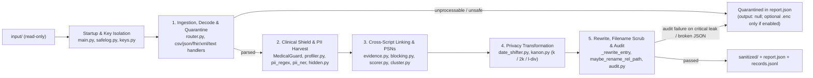

# Project RAKSHA — Offline Privacy Firewall for Multilingual Health Records

**Track 3 · Secret Wards** · **Team Poker Face** (Suyash Krishan Garg, Manish Yadav, Shubh Singh Rajput, Khushi Sarawagi) · Repository: https://github.com/Neo-Venom/PokerFace

Project RAKSHA is an **offline, CPU-only, zero-ML privacy firewall** for multi-hospital Indian healthcare exports (CSVs, TSVs, nested JSON/JSONL, FHIR R4 JSON Bundles, XML, and English/Devanagari/Hinglish free-text notes). It detects direct and encoded identifiers via dual-signal profiling, rules, gazetteers, transliteration, and runtime-harvested lexicons while keeping clinical measurements intact; links patient records across scripts under keyed `HKDF-SHA256` / `HMAC-SHA256` pseudonyms (`PSN-XXXXXXXX`) with hard contradiction vetoes; applies per-patient date shifting and patient-pooled k-anonymity; and runs a pre-emission audit gate before emitting `sanitized/`, `report.json`, and `records.jsonl`.

---

## 1. Setup, Run Commands & `RAKSHA_SECRET`

Requires Python 3.10+ and pure-CPU packages (`requirements.txt` contains 7 packages, 0 LLMs, and 0 ML weights; runs completely offline). Matching `raksha.toml`:

```bash
pip install -r requirements.txt
export RAKSHA_SECRET="replace-with-random-secret"
python main.py --input /path/to/input --output /path/to/output
```

On Windows PowerShell:

```powershell
$env:RAKSHA_SECRET = "replace-with-random-secret"
python main.py --input .\input --output .\output
```

- **Supplying `RAKSHA_SECRET`:** Pass the secret via the `RAKSHA_SECRET` environment variable (never commit real secrets or `.env` files to the repository). On startup, `KeyRing.from_env(scrub_env=True)` derives four domain-separated subkeys (`pseudonym`, `date-shift`, `file-name`, `vault`) and pops `RAKSHA_SECRET` from `os.environ` (`src/security/keys.py`). Disclosed fallback gap: if `RAKSHA_SECRET` is unset or empty, `KeyRing` currently falls back to a fixed default key instead of failing closed (see [Security & Disclosed Gaps](#5-security-design--disclosed-gaps)).

### Output Layout

```text
output/
├── sanitized/       # UTF-8 sanitized files mirroring safe relative paths
│                    # (PII-bearing filenames renamed deterministically to doc_<8-char-tag><ext>)
├── report.json      # Schema raksha-report/1: per-file status/reason, counts, entities, timing, peak_rss_mb
├── records.jsonl    # Sorted (file, loc) mapping: {"file": "sanitized/...", "loc": "...", "patient": "PSN-..." | null}
└── quarantine/      # NOT created by default (encrypt_quarantine_archive: false in config/policy.yaml).
                     # Created only when encrypt_quarantine_archive: true -> stores <rel_input_path>.enc blobs.
```

- Standard output prints one summary count line (`files N sanitized M quarantined K records R`); no `logs/` directory or scratch temp files are written under `output/`, `TMPDIR`, or `HOME`.

---

## 2. System Architecture

Pipeline execution order matches [`src/pipeline.py`](src/pipeline.py) (`run_pipeline`):



---

## 3. How Each Stage Works

### Ingestion (`src/ingest/`)
- **Supported formats & encodings:** Processes `.csv`, `.tsv`, `.json`, `.jsonl`, `.ndjson`, `.txt`, `.md`, `.log`, `.xml`, FHIR R4 JSON Bundles (`resourceType == "Bundle"`), and JSON files misnamed `.csv` (`router.py`). Strictly decodes `UTF-8`, `UTF-8-BOM`, `UTF-16 LE/BE` (with/without BOM), and `cp1252`; sparse injected NUL bytes (`<=0.5%` of bytes) are replaced with spaces to salvage valid exports instead of dropping entire tables.
- **Hardened parsing:** Repairs ragged CSV rows (unquoted commas merged into address/notes columns), neutralizes spreadsheet formula cells starting with `=`, `+`, `-`, `@`, `\t`, or `\r` with a leading `'` (OWASP CSV-injection protection), checks JSON nesting depth iteratively prior to parsing (`max_json_depth: 500`), rejects non-standard `NaN`/`Infinity` JSON tokens, and parses XML with `defusedxml` to block XXE/DTD expansion.
- **Quarantine policy:** Unsupported binaries (`%PDF`, JPEG/PNG/GIF, ZIP/PK, SQLite magic bytes), undecodable/corrupt binary files, empty files, malformed/over-deep JSON, XML parse failures, unsafe filenames containing shell metacharacters / control bytes / `..` traversal (`_UNSAFE_NAME_RE`), and free-text lines exceeding `65,536` chars (`_MAX_TEXT_LINE`) are quarantined (`output: null` in `report.json`).

### Detection (`src/nlp/`, `src/ingest/profiler.py`, `src/ingest/hidden.py`)
- **Schema-agnostic column/key profiling:** Combines header/key synonyms (English, Hindi, Hinglish) with cell-value shape statistics so unfamiliar column names (e.g., `holder`, `abode`, `F7`) resolve from content (`profiler.py`).
- **Clinical shield & meaning traps:** `MedicalGuard` seeds from `data/clinical_vocab.py` and `data/gazetteers.py` plus clean input docs/clinical columns at runtime. Protects doctors (`Dr. ...` / `Practitioner`), credentials, ASHA/ward phrases, `K/C/O` and `H/O` clauses, medical eponyms (e.g., `Parkinson's`, `Addison's`, hyphenated and unknown possessive eponyms), government schemes (`Ayushman Bharat`, `PM-JAY`), dosage schedules (`1-0-1`, `OD`/`BD`), lab values, ICD-10 codes, and `C/O <complaint>` vs relative `C/O <name>`.
- **Multilingual patterns & context NER:** Zero ML models. `pii_regex.py` extracts ABHA (`14-digit` & `@abdm`/`@sbx`/`@ndhm`), email, PAN, Aadhaar (masked & 12-digit), phones across multi-format groupings, insurance/PMJAY IDs, shape-based MRN/UHID/IPD/OPD IDs, driving licence / vehicle / passport / UPI VPAs, and labelled bank/voter/ration/policy IDs. `pii_ner.py` extracts English, Devanagari, and Hinglish names via honorifics, age/sex anchors, `S/o`/`D/o`/`W/o` relatives, and Hinglish syntactic frames, redacts non-district address tokens fail-closed, transliterates Devanagari via `indic-transliteration` (ITRANS + phonetic skeletons), and sweeps all harvested entities corpus-wide (`Harvest-Then-Sweep`).
- **Hidden-channel decoding:** `hidden.py` decodes `%XX`, numeric HTML entities, `\uXXXX` escapes, BiDi RLO/zero-width obfuscation, Cyrillic/Greek homoglyphs, hex strings, standard/URL-safe Base64, and gzip+Base64 payloads (up to `_MAX_DECODED = 8 MiB` and `_MAX_DEPTH = 4`), re-encoding redacted payloads cleanly. Binary attachment blobs (`>=200` chars or readable PII runs) become a Base64 `[ATTACHMENT_REDACTED]` placeholder.

### Linking & Pseudonyms (`src/linkage/`)
- **Signals & cross-script matching:** `evidence.py` and `blocking.py` generate candidate pairs across shared UHIDs/cores, gov IDs, phones, emails, names, relatives, birth year/DOB, village, and district. `scorer.py` computes IDF-weighted Fellegi–Sunter weights with transliteration-aware Jaro–Winkler + vowel/aspiration-folded consonant similarity (`MATCH = 0.88`, `COMPAT = 0.85`).
- **Safety rails & conflict vetoes:** Hard vetoes block merges across differing Aadhaar/ABHA/PAN/last-4 digits, incompatible sex or age/birth year, non-episode same-system MRNs, family/attendant shared phones when distinguishing names/DOBs exist, twins/parent-child collisions, and multi-patient summary tables. Weak records (e.g., first name + relative without IDs) attach only above `FRAGMENT_MARGIN = 2.5` and `FRAGMENT_MAX_COINCIDENCE = 0.25`; otherwise ambiguous or multi-patient records stay `patient: null` in `records.jsonl`. Linked clusters receive `PSN-<8 Crockford Base32 chars>` via `HMAC-SHA256(k_psn, cluster_key)`.

### What Distinguishes Our Design (USP)
1. **Header+Value Dual-Signal Profiling:** Tables and nested JSON are classified from both bilingual header cues and observed value shapes, preventing broken redaction when columns are renamed or shifted.
2. **Precision-First Cross-Script Identity Rails:** Devanagari and Latin/Hinglish mentions link via phonetic/consonant folding, while explicit conflict vetoes, family-phone separation, and `patient: null` abstention protect against false merges.
3. **Hostile-Export & Egress Hardening:** Neutralizes CSV formulas, strips unsafe filenames, handles sparse NUL bytes and deep-JSON/long-line bombs deterministically, decodes multi-layer obfuscations, and re-audits released files before exit.

---

## 4. Privacy & Utility Trade-off

Configured in [`config/policy.yaml`](config/policy.yaml):

| Parameter / Rule | Actual Behavior (`config/policy.yaml`, `src/privacy/kanon.py`, `src/nlp/date_shifter.py`) | Utility Retained vs Privacy Cost |
|---|---|---|
| **Date shifting** | Per-patient HMAC-seeded shift (`±30..180` days), dodging any DOB in the cluster/file (`#nodob` disambiguation); format preserved across ISO, DMY/MDY, named months, compact HL7, Devanagari digits. | Preserves exact **length of stay** and visit intervals; resists global-shift recovery, though known admit/discharge + clinical profile stays traceable under targeted attack (`A5`). |
| **Age bands & DOB** | Patient-pooled ladder over **distinct clusters**: `5y -> 10y -> 20y -> (0-17 / 18-59 / 60+) -> (0-17 / 18-120)`, `age_top_code: 85`; invalid/overflow ages -> `[AGE]`; exact `birthDate` / DOB suppressed or replaced with birth cohort. | Small releases or outliers widen to broader truthful bands to reach cohort anonymity without dropping records (`records_suppressed: 0`). |
| **Rare-diagnosis rule** | Conditions in `< 4` patient clusters (`rare_dx_min_patients: 4`, ignoring complaint durations) require **`2k` (`10`) distinct patients** in `(gender, district, age_band)` plus `l_diversity: 2` distinct primary diagnoses — **stricter `k`, NOT ICD rollup**. | Keeps exact clinical diagnosis text intact for public-health research instead of rolling up codes; trades age-band/PIN granularity instead. |
| **Geography & PIN** | District kept for research utility; village, mohalla, house, and landmark removed or rolled up; tehsil suppressed unless `(gender, district, tehsil)` has `>= 5` patients; 6-digit PIN masked to 3 digits (`123***`) when cohort reaches `k` (or `2k` if rare dx), else suppressed (`location_min_group: 3` in config). | Removes sub-district uniqueness while keeping district trends; fails closed inside address fields (may also mask facility/landmark strings in address cells). |

---

## 5. Security Design & Disclosed Gaps

### Implemented Controls
- **Subkey separation & env scrub (`src/security/keys.py`):** `KeyRing.from_env(scrub_env=True)` derives `pseudonym`, `date-shift`, `file-name`, and `vault` subkeys via `HKDF-SHA256` (`salt=b"secret-wards-raksha-v1"`), pops `RAKSHA_SECRET` from `os.environ`, and calls `keyring.clear()` at pipeline end. Rotating `RAKSHA_SECRET` changes all `PSN-` IDs, date shifts, and renamed filenames.
- **PII-safe logging (`src/security/safelog.py`):** Suppresses warnings, formats logs as `[LEVEL] message`, and replaces uncaught tracebacks with `FATAL: <ExcType>`. `--input` is read-only; no temporary PII files are created.
- **Pre-emission audit (`src/privacy/audit.py`):** Scans `sanitized/` filenames, text bodies, and decoded Base64/`%XX`/hidden views; attempts fallback re-scrubbing on dirty outputs and quarantines broken JSON, dirty filenames, leaked secrets (`len >= 4`), or persistent critical IDs (`ABHA_NUMBER`, `ABHA_ADDRESS`, `EMAIL`, `PAN`, `AADHAAR_MASKED`, `INSURANCE_ID`), removing quarantined paths from `records.jsonl`.
- **Optional quarantine encryption (`src/security/vault.py`):** When `encrypt_quarantine_archive: true` is set, raw quarantined bytes are written as `quarantine/<rel_input_path>.enc` sealed with `AESGCM` (12-byte random nonce, `vault` subkey, `input_sha256` as AAD).

### Disclosed Security & Validation Gaps (Verified in Code)
1. **Encryption at rest is OFF by default (`config/policy.yaml:12`):** `encrypt_quarantine_archive: false`. Released `sanitized/`, `report.json`, and `records.jsonl` are plaintext UTF-8 (per track contract), and quarantined originals are **not** stored on disk by default (`output: null` only). Even when `vault` is enabled, `quarantine/<rel_input_path>.enc` keeps the input relative path in the `.enc` filename (`pipeline.py:866,887`).
2. **Empty/missing `RAKSHA_SECRET` fallback (`src/security/keys.py:28`):** If `RAKSHA_SECRET` is empty or unset, `KeyRing` uses hardcoded `b"default-empty-secret-guard"` instead of failing closed.
3. **Short secrets & startup UTF-8 re-exec (`main.py:11-13`, `src/pipeline.py:734,890`, `src/privacy/audit.py:75`):** Under non-UTF-8 locales, `main.py` re-execs `python -X utf8` before popping `RAKSHA_SECRET`. `secret_for_audit` remains in local RAM until after `run_egress_audit()`, and secrets shorter than 4 chars bypass the secret-in-output leak check.
4. **Unbounded decompression & audit gaps (`src/privacy/audit.py`, `src/ingest/fhir_handler.py`):** While `src/ingest/hidden.py` caps gzip decompression at 8 MiB, `src/privacy/audit.py:55` calls unbounded `gzip.decompress(raw)`, and `src/ingest/fhir_handler.py:27` calls `base64.b64decode` without an input cap. `audit.py`'s `_B64_RE` scans standard Base64 only (`[A-Za-z0-9+/]`), skips PII checks on files marked `is_clean_doc` (only scanning for `secret_str`), and mandates quarantine only for `_CRITICAL_RX_KINDS` (residual `MRN`, `PHONE`, `PIN`, `AADHAAR`, and names rely on best-effort re-scrubbing).
5. **Structural FHIR handling only:** `sanitize_fhir_bundle()` preserves FHIR bundle structure, `urn:uuid:` links, and `Practitioner`/`Organization` blocks structurally; it is **not** a full HL7 FHIR R4 validator.
6. **No formal anonymity/zero-leak guarantee:** Output on unseen distributions is not guaranteed to be leak-free or immune to linkage/known-fact attacks.

---

## 6. Declared Models, Dependencies & Data

- **Models: None.** No LLM, no generative AI, no CRF/neural weights, and no pretrained or trained ML model (`0` parameters).
- **Runtime Dependencies (`requirements.txt`, CPU-only, offline):**
  - `regex==2026.11.25`
  - `rapidfuzz==3.14.6`
  - `jellyfish==1.3.0`
  - `indic-transliteration==2.3.83`
  - `cryptography==50.0.2`
  - `defusedxml==0.7.1`
  - `pyyaml==6.0.4`
- **Bundled Data (`data/`):** Contains only static runtime support tables (`data/clinical_vocab.py`, `data/gazetteers.py`): drug names, clinical terms/abbreviations/eponyms, Hinglish stopwords, honorifics, generic Indian names, public district/state names, and static ICD-10 chapter/block titles. Contains **zero** dataset truth keys or holdout lists.
- **Presentation Demo (`ui/`):** Optional local stdlib web server (`python ui/server.py`, `127.0.0.1:8765`) for interactive demonstration only; never imported by `main.py` or `raksha.toml`.

---

## 7. Tests & Measured Self-Test Results (Not Official Scores)

### Unit Tests (`60` tests across 5 modules)
- [`tests/test_generalization.py`](tests/test_generalization.py) (`16`): unseen shapes, headers, context cues, dates, end-to-end generalization.
- [`tests/test_hardening.py`](tests/test_hardening.py) (`15`): ingestion quarantine, locale independence, output hygiene, meaning traps, detection, linkage edges.
- [`tests/test_linkage.py`](tests/test_linkage.py) (`12`): evidence, Fellegi–Sunter scorer, constrained clustering.
- [`tests/test_kanon.py`](tests/test_kanon.py) (`9`): age ladder, planner (`k`/`2k`/`l_diversity`), geo generalization.
- [`tests/test_raksha.py`](tests/test_raksha.py) (`8`): core regex/evasion, cross-script canonicalization, date shifting, FHIR/WhatsApp/vault, HKDF determinism.

Verified on commit `aea3847f3e1bf84b6e5e732d247f6c6270a7f90c` (same runtime code, config, and data as `HEAD`):
- **Linux WSL2 (`Python 3.14.4`):** `python -m unittest discover -s tests -p "test_*.py" -v` -> **`Ran 60 tests in 0.717s OK`**; `pytest -v` -> **`60 passed in 1.03s`**.
- **Windows (`Python 3.15`):** `pytest -v` -> **`59 passed, 1 skipped` in `1.34s`** (`test_devanagari_file_names_under_bare_c_locale` skipped on Windows); `unittest` -> `60 tests OK (skipped=1)` in `0.468s`.

### Measured Self-Test & Debugging Results (Commit `aea3847` — Code, Config & Data Unchanged)

> **Important:** Practice, Synthetic set, Stress set, and Gauntlet are **self-test / debugging runs**, **not** unseen official test datasets and **not** official scores. Official hidden scoring is **not measured**. Note: `check_dev.py` compares `input_sha256` against LF line endings; on an LF checkout (`check_submission.py --run` + `check_dev.py` + `validate_output.py`), filename renaming matches truth SHA-256 identically.

| Self-Test / Debugging Dataset | Contract | PII Leaked | Canaries | Medical Kept | Linking Recall / F0.5 / Wrong Merges | Runtime & Peak RSS (Machine) | Local Score / Attack Sim |
|---|---|---|---|---|---|---|---|
| **Practice (LF, offline 2-CPU WSL2)** *(verified on HEAD)* | `CONTRACT OK` | **`0 / 3,230` (0.0%)** | **`0 / 4`** | **`4,855 / 4,855` (100.0%)** | **R=`1.00`, P=`1.00`, F0.5=`1.00`, `0`** | **`11.08s` wall (`10.73s` report) · `69.99 MiB` (`71,672 KiB`)** (`unshare -rn`, `taskset -c 0,1`, i5-10400H WSL2) | Official score: **not measured** · Attack sim *(Windows `aea3847`)*: `A3 1.9%`, `A4 2.1%`, `A5 58.3%` |
| **Practice (Windows baseline `aea3847`)** | `CONTRACT OK` | `0 / 3,230` | `0 / 4` | `4,855 / 4,855` | `R=1.00`, `F0.5=1.00`, `0` | `11.69–12.03s` · `61.68 MB` (Windows) | `check_submission.py`: WSL pass (`11.5s`, 3 runs, deterministic, key rotation clean) |
| **Synthetic set (debugging, `aea3847`)** | `CONTRACT OK` | `45 / 42,866` (`0.10%`: 26 patient names, 10 relatives, 5 locality, 4 PIN) | `1 / 6` (`CAN06 bp-456178`) | `45,862 / 45,883` (`history 93.3%`, stays `80/83`) | `R=0.8174`, `F0.5=0.9572`, **`1` cluster** (`PSN-2YP7Y1PK` shifted OPD row) | `119.38s` · `413.97 MB` (Windows) | Official score: **not measured** |
| **Stress set (debugging, `aea3847`)** | `CONTRACT OK` | `15 / 811` (8 direct IDs in penalty) | `2 / 4` | `185 / 200` (stays `40/46`) | `R=0.54`, `F0.5=0.85`, `0` | `1.58s` · `44.3 MB` (Windows; 3 valid files quarantined) | Local bench score: **`76.97 / 100`** (`raw 90.97`, `-14.0` penalties) |
| **Gauntlet A7 / B11 / H7 / H11 (debugging, `aea3847`)** | `CONTRACT OK` | `0` (`H11`: `'kaveri'` strict leak) | `0` | not separately tallied | `0` wrong merges (`H11` `PT00012` split) | `15.96–22.82s` · `133.4–136.6 MB` (Windows) | Local evaluator: **`99.70–99.76 / 100`** |

- **Official holdout evaluation:** **not measured**.

---

## 8. Verified Known Limitations

1. **Unfamiliar ID prefixes, encoded payloads, and canaries can leak** (e.g., Synthetic set `CAN06 bp-456178`, Stress set direct IDs/canaries).
2. **Shared doctor and patient names** can cause misses when clinical-span protection shields overlapping patient names.
3. **Shifted CSV rows** can cause leaks, lost data, or wrong merges (observed as the `PSN-2YP7Y1PK` false merge on `shifted_col_opd_dump.csv` in the synthetic debugging set).
4. **Hindi duration phrases** (or non-standard duration expressions) can be mistaken for ages during inline generalization.
5. **Some valid files are quarantined** by strict size/depth/filename caps (e.g., `max_json_depth: 500`, `64 KiB` line limit, or strict filename character filters observed on the Stress debugging set: `deep_1500.json`, `ocr_72kb.txt`, `ward;batch$2.csv`).
6. **Some linked records lack the pseudonym inside the sanitized record** even when linked in `records.jsonl` (observed `9,713 / 9,829` consistency on the Synthetic debugging set).
7. **Known-fact attacks remain a significant risk** (`A5 = 58.3%` in Practice attack simulation): exact length of stay plus clinical diagnoses remains identifying in small cohorts unless suppressed.
8. **Zero leakage on unseen data is not guaranteed**; additionally, other Indic scripts beyond Latin/Devanagari (e.g., Tamil/Bengali) lack script-specific transliteration, and single-file runs lack cross-file corpus priors.
